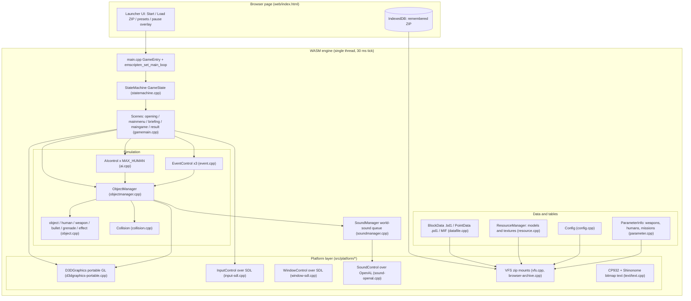
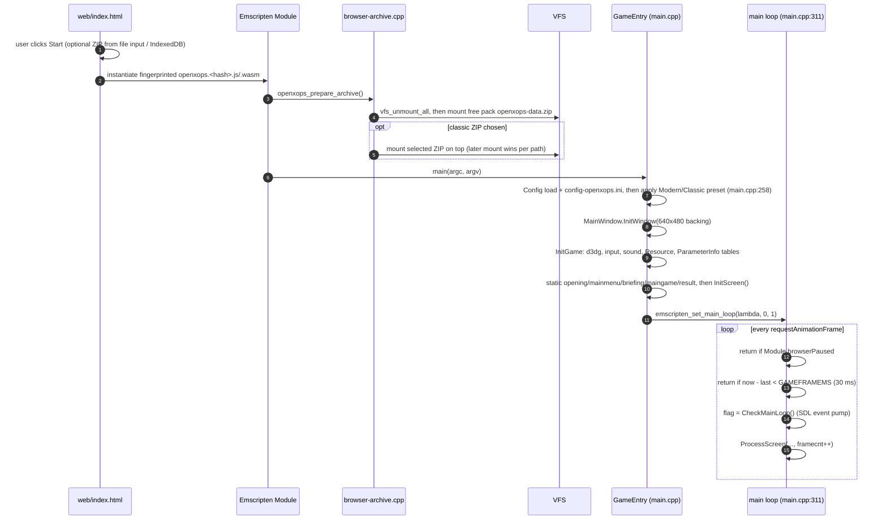
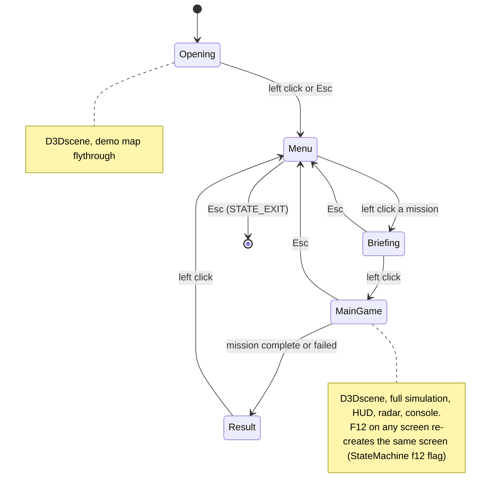
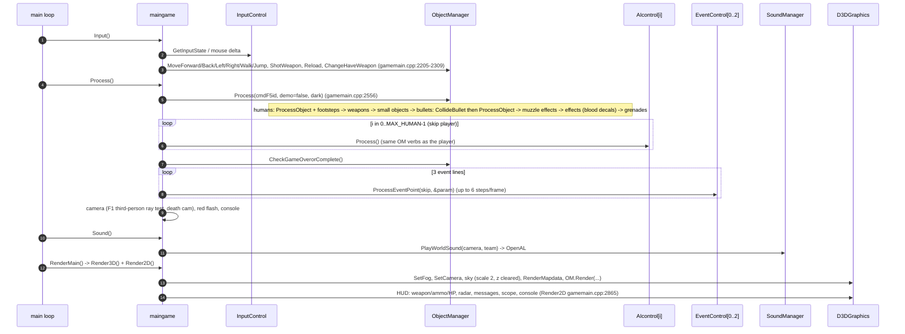
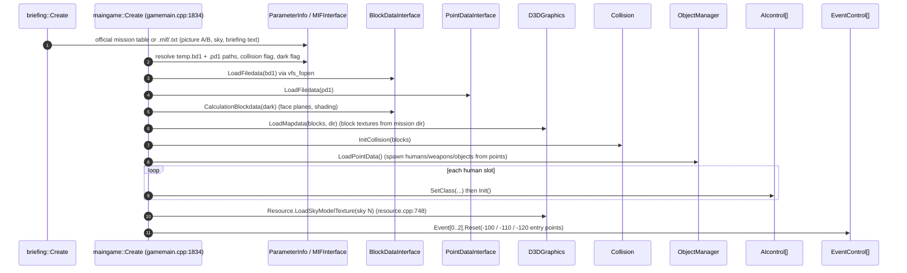
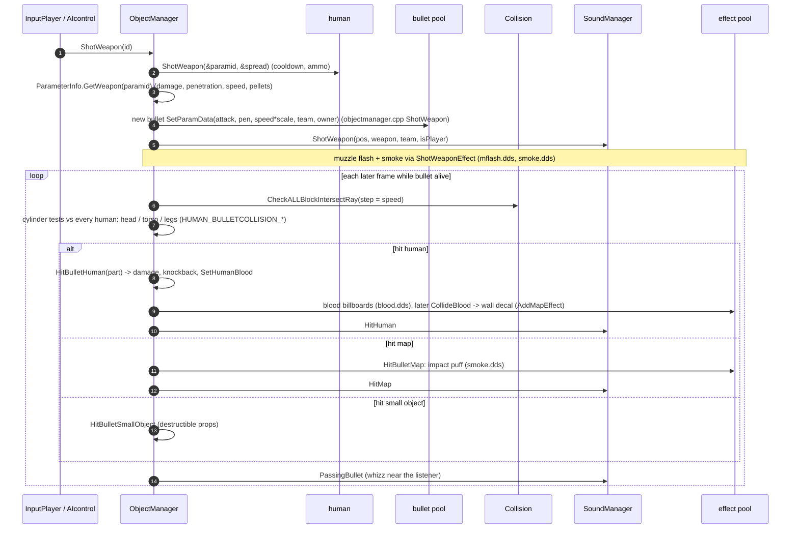
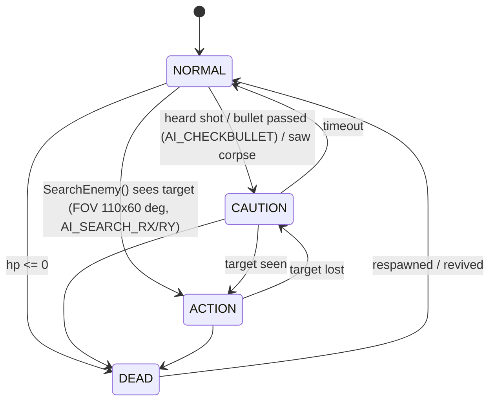
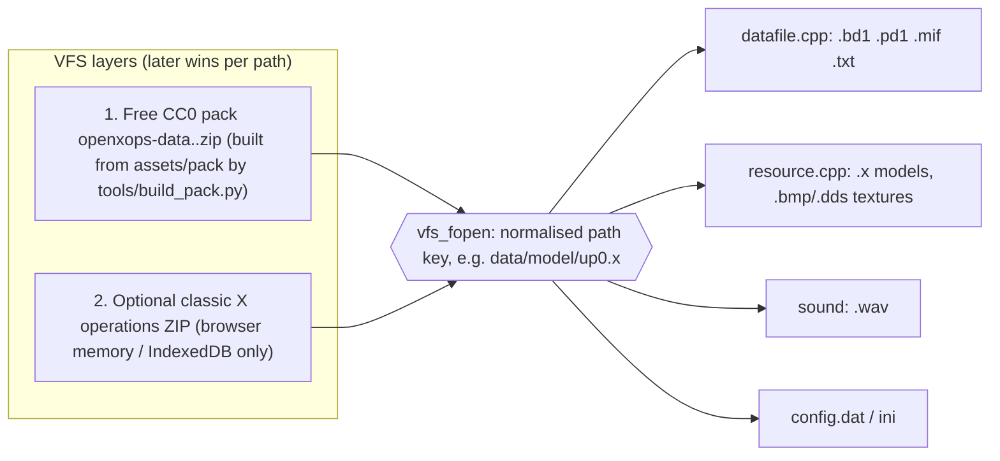
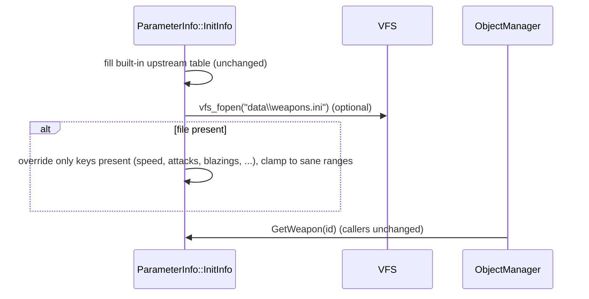

# OpenXOPS-web architecture

How the game is put together, how one frame runs, and where improvements can go
in without losing the original look and feel. Every claim cites a source
location (paths are relative to the repo root; line numbers are as of this
writing, so use them as "search near here", not as exact anchors).

GitHub renders the `mermaid` blocks as diagrams.

Contents

1. Big picture
2. Layers and modules
3. Boot: from the browser page to the first frame
4. The scene state machine
5. One frame of gameplay
6. Loading a mission
7. Firing a shot: input to bullet to hit to blood, smoke and sound
8. AI
9. Data, the VFS and the free pack
10. Rendering
11. What gives the game its feel (keep these fixed)
12. Where to add improvements
13. Rules for changing the code

---

## 1. Big picture

OpenXOPS is a single-threaded, fixed-tick C++ game of about 25k lines of
game logic. Everything hangs off a set of global singletons, and the main
loop runs a hand-written scene state machine (opening, menu, briefing, game,
result). The game itself has three parts:

- `ObjectManager` owns fixed-size arrays of every entity (humans, weapons,
  bullets, grenades, effects, small objects) and does all of their
  simulation and collision.
- `AIcontrol` makes one decision per non-player human per frame. It drives
  that human through the same `ObjectManager` verbs the player's input uses.
- `EventControl` runs mission scripts: three "event lines" read from the
  point file.

The rendering, input, window and sound APIs are swapped at build time by
`#define`. The web port adds a portable GL renderer, SDL window and input,
OpenAL sound, and a virtual file system (VFS) that mounts zip archives.

## 2. Layers and modules

| Layer | Files (lines) | Owns | Notes |
|---|---|---|---|
| Entry and loop | `src/main.cpp` (492) | Globals, `GameEntry`, main loop | Browser loop at main.cpp:311-323; native loop at :326 |
| Scenes | `src/scene.{h,cpp}` (274), `src/gamemain.{h,cpp}` (5132) | The 5 screens, HUD, radar, debug console | `scene` → `D2Dscene` / `D3Dscene` (scene.h:40-100) |
| State machine | `src/statemachine.cpp` (299) | `enum State` CREATE / NOW / DESTROY × screen | statemachine.h:41-59 |
| Entities | `src/object.{h,cpp}` (3580) | `human`, `weapon`, `smallobject`, `bullet`, `grenade`, `effect`, `HumanMotionControl` | object.h:95-372; movement constants at object.h:36+ |
| Entity manager | `src/objectmanager.{h,cpp}` (3396) | Fixed pools, per-frame `Process`, collision dispatch, hit responses, effects | Pools at objectmanager.h:35-41 |
| AI | `src/ai.{h,cpp}` (2371) | `AIcontrol` (decides), `AIMoveNavi` (paths), `AIObjectDriver` (move and turn flags) | Modes AI_DEAD / ACTION / CAUTION / NORMAL (ai.h:196) |
| Events | `src/event.cpp` (352) | Mission script interpreter | Point-type cases at event.cpp:289-341 |
| Collision | `src/collision.cpp` (1654) | Block-face rays, inside tests, sliding | Map blocks only; entity hits live in ObjectManager |
| Data files | `src/datafile.cpp` (1698) | `.bd1` blocks, `.pd1` points, `.mif` / `.txt` mission, addon list, INI | MAX_BLOCKS 160, MAX_POINTS 256 (datafile.h:35-39) |
| Static tables | `src/parameter.cpp` (2126) | Weapon / human / bullet / AI-level / scope / official-mission tables | **Hard-coded**: `Weapon[0].name = ...` at parameter.cpp:505+ |
| Resources | `src/resource.cpp` (918) | Load and cache models and textures by table id | Sky :748, effects :855 |
| Sound | `src/soundmanager.cpp` (673), `src/platform/openal/sound-openal.cpp` | Queue of game-level world sounds and their spatial playback | ShotWeapon / HitMap / Footsteps ... (soundmanager.cpp:82-276) |
| Rendering | `src/d3dgraphics.h` (418) + `src/platform/portable/d3dgraphics-portable.cpp` (2942) | Models, map, billboards, 2D text and HUD | Upstream D3D9 / GL1.1 files are kept but not built for the web |
| Platform | `src/platform/{sdl,openal,portable,text,stub}/`, `vfs.cpp`, `compat.h` | SDL window and input, VFS, CP932 text, stubs for headless tests | 37 `[OpenXOPS-web]` markers flag port edits in upstream files |
| Launcher | `web/index.html` | Start, optional ZIP, IndexedDB, Modern/Classic controls, pause overlay | Talks to the engine through `Module.*` flags |
| Content tools | `tools/mapgen`, `tools/modelgen`, `tools/artgen`, `tools/build_pack.py` | The clean-room CC0 pack | See MAPGEN.md, MODELGEN.md, OPEN-ASSETS-SOW.md |

How the backends are chosen: `tools/build-playable-web.sh:10-16` compiles 17
upstream units plus the platform files, with `-DGRAPHIC_ENGINE=8
-DINPUT_INTERFACE=3 -DSOUND_ENGINE=3 -DOPENXOPS_PORTABLE_GL ...`. The game
code only ever talks to the class names `D3DGraphics`, `InputControl`,
`SoundControl` and `WindowControl`. These are the main seam for swapping
platform backends.

## 3. Boot: from the browser page to the first frame

The browser loop throttles to the original 30 ms tick (`GAMEFRAMEMS`,
main.h:54). It is a fixed step with no catch-up: when the browser runs slow,
the game runs in slow motion rather than skipping frames, exactly like the
original `ControlFps()`.

## 4. The scene state machine

`ProcessScreen` (gamemain.cpp:4860) switches on `GameState.GetState()`. Each
screen has CREATE, NOW and DESTROY states. During NOW it calls
`Input()`, `Process()`, `Sound()` and then `RenderMain()` (skipped on odd
frames when frame-skip is on, gamemain.cpp:4889-4893).

Each state is really three: for example `STATE_CREATE_MENU` →
`STATE_NOW_MENU` → `STATE_DESTROY_MENU` (statemachine.h:44-58). A scene asks
to leave by calling `GameState->PushMouseButton()` (forward),
`PushBackSpaceKey()` (back, i.e. Esc) or `PushF12Key()` (restart this
screen). `StateMachine::NextState` (statemachine.cpp) then picks the next
CREATE state from the `back` and `f12` flags. Scenes never pick their
successor themselves.

## 5. One frame of gameplay

`maingame` calls run in this order each frame. The simulation steps come from
`maingame::Process` at gamemain.cpp:2536.

Key properties:

- **Input and AI share one interface.** The player
  (`maingame::InputPlayer`, gamemain.cpp:2173) and the AI
  (`ObjMgr->MoveForward/ShotWeapon/...` in ai.cpp) both press the same
  "virtual buttons" on `ObjectManager`. Anything a player can do, an AI can
  do, and the reverse.
- **Effects are the outputs of the simulation.** Sounds are queued into
  `SoundManager` as events (ShotWeapon, HitMap, HitHuman, Footsteps,
  PassingBullet) and resolved against the camera once per frame. Visual
  effects are `effect` billboards in a 256-slot pool.
- **Everything has a fixed capacity.** MAX_HUMAN 96, MAX_WEAPON 200,
  MAX_BULLET 128, MAX_GRENADE 32, MAX_EFFECT 256, MAX_SMALLOBJECT 40
  (objectmanager.h:35-41); MAX_BLOCKS 160, MAX_POINTS 256 (datafile.h).
  Nothing is allocated mid-frame.

## 6. Loading a mission

The free starter goes through exactly this path. It is listed in
`data/missions.txt` and authored in
`tools/mapgen/examples/starter_compound.json`.

## 7. Firing a shot: input to bullet to hit to blood, smoke and sound

Bullets are real projectiles that move `speed` units per 30 ms tick, not
instant hitscan. Each tick they are ray-tested against the map and
cylinder-tested against humans. This is a big part of how the original
plays.

## 8. AI

`AIcontrol::Process` (ai.cpp:1934) is a three-mode state machine. Each mode
handles both moving (patrol paths from `.pd1` waypoints) and fighting.

- Decisions turn into movement through `AIObjectDriver` mode flags
  (forward / back / turn, ai.cpp:2251+), which then call the `ObjectManager`
  verbs.
- Difficulty comes from `ParameterInfo::GetAIlevel` tables (parameter.cpp:2105):
  aim error, reaction time, how often the AI fires. The turn rate is a single
  constant, `AI_ADDTURNRAD` = 0.8°/frame (ai.h:37).
- Paths: `AIMoveNavi` follows `.pd1` waypoint chains (point type and
  parameters, see docs/MAPGEN.md). There is no navmesh. The AI checks for
  obstacles with short rays ahead (`AI_CHECKJUMP_*`) and jumps over them.

## 9. Data, the VFS and the free pack

- Formats and loader rules are in docs/ASSET-CONTRACT.md: BMP/DDS only,
  `.x` text meshes, `.bd1` blocks with 6 faces × per-face texture + UV,
  `.pd1` points. The manifest has 353 slots, and `tools/validate_pack.py`
  checks the pack against it.
- What is code and what is data. Map geometry, spawn and patrol points,
  mission scripts, models, textures, sounds and briefing text are all data.
  Weapon stats, human types, bullet and AI-level tables, scopes and the
  official mission list are **compiled in** (parameter.cpp).

## 10. Rendering

`D3DGraphics` (d3dgraphics.h, about 40 public methods) is a small immediate-
mode API: `LoadModel/LoadTexture`, `SetCamera`, `SetWorldTransform`,
`RenderModel`, `RenderMapdata`, `RenderBoard` (billboards), `Draw2D*`
(boxes, textures, bitmap fonts, CP932 text) and `SetFog`.

- The web build uses `src/platform/portable/d3dgraphics-portable.cpp`:
  legacy fixed-function GL through Emscripten `LEGACY_GL_EMULATION`.
- Models have no lighting. Their vertex colour is fixed at 1.0, or 0.8 when
  dark (d3dgraphics-portable.cpp:464-476). Map faces get a per-face shade
  baked by `CalculationBlockdata`. Fog is linear from 100 to 800 units, with
  a colour per sky number. Textures use `GL_LINEAR` without mipmaps.
- The backbuffer is a 640×480 logical screen. HUD code works in 640×480
  coordinates (`*Scaling` variants), and CSS scales the canvas.
- Draw order: sky (camera-centred, scale 2, then the Z buffer is cleared),
  then the map, then objects, then effects, then the 2D HUD.

## 11. What gives the game its feel (keep these fixed)

These choices are what make it feel like X operations. A change that alters
one of them changes the game, not just its polish.

| # | Invariant | Where it lives |
|---|---|---|
| F1 | Fixed 30 ms tick with no catch-up; all speeds are per tick | main.h:54, main.cpp:311-323 |
| F2 | Movement acceleration and inertia constants | object.h:36-60 (HUMAN_*_ACCELERATION) |
| F3 | Projectile bullets with per-weapon speed, spread and penetration; head/torso/leg cylinders | objectmanager.cpp CollideBullet; parameter.cpp weapon table |
| F4 | Two weapon slots plus grenades (TOTAL_HAVEWEAPON 2) | main.h:62 |
| F5 | Blocky `.bd1` world (≤160 blocks, 6 faces each), flat baked shading, linear fog | datafile.h:35, CalculationBlockdata |
| F6 | Unlit low-poly `.x` people and weapons, rigid-part animation (no skinning) | object.cpp human::Render, HumanMotionControl |
| F7 | 640×480 HUD layout, bitmap fonts, radar | gamemain.cpp Render2D / RenderRadar |
| F8 | AI: 3 modes, waypoint patrols, FOV cone, 0.8°/frame turning | ai.h:37-49 |
| F9 | Event-line mission scripting (3 lines, ≤6 steps per frame) | event.cpp, gamemain.h:57 |
| F10 | Positional world sounds that respect teams | soundmanager.cpp |

## 12. Where to add improvements

Each row names the hook (the narrowest place to make the change), what it
enables, and the risk to the feel. Low means the feel invariants are
untouched. Medium means it is opt-in or tunable. High means it changes the
game.

| Area | Hook (inject here) | Improvement it enables | Feel risk | Guardrail |
|---|---|---|---|---|
| Content | `assets/pack` + `tools/{mapgen,modelgen,artgen}` | New maps, skins, sounds, missions | Low | Stay inside ASSET-CONTRACT budgets (polygons, 256² textures, MAX_BLOCKS) |
| Missions | `data/missions.txt`, `.txt/.mif`, `.pd1` event points | New campaigns, objectives using the existing event opcodes | Low | Reuse event.cpp cases 10-19/29 before adding opcodes |
| Event opcodes | New `case` in `EventControl::ProcessEventPoint` (event.cpp:289+), reserved type range | Richer scripting (counters, triggers, spawn waves) | Low–Medium | Keep the 6-steps-per-frame budget; unknown types stay no-ops so classic maps are unaffected |
| Data-driven weapons | Replace `ParameterInfo::InitInfo` constants with defaults plus an optional `data/weapons.ini` overlay read through the VFS | Modding weapon stats without recompiling | Low if the defaults are byte-identical | A unit test asserting the default table equals the upstream constants |
| Rendering polish | `d3dgraphics-portable.cpp` only (behind `D3DGraphics`) | Mipmaps and anisotropic filtering, MSAA, integer-scale or CRT-style post filter, sharper text | Medium | Make each one a launcher option, default off or very subtle; never change model or vertex colour math (F6) |
| Resolution | `Draw2D*Scaling` + `SetCamera` aspect | Widescreen 3D view with a 4:3 HUD safe area | Medium | Keep 640×480 HUD coordinates; widen only the 3D frustum |
| Input | `src/platform/sdl/input-sdl.cpp`, `browser-controls.cpp`, `maingame::InputPlayer` | Gamepad, touch, rebinding UI, raw-input sensitivity curves | Low | Map to the existing virtual keys (`TOTAL_ControlKey` 18); never bypass ObjectManager verbs |
| Sound | `SoundManager::PlayWorldSound` / `sound-openal.cpp` | HRTF, distance-curve tweaks, volume sliders | Low–Medium | Keep the event list and team rules; tune falloff only behind an option |
| AI tuning | `ParameterInfo::GetAIlevel` tables, `AI_*` constants | Difficulty presets | Medium | Add new levels; don't edit existing ones |
| AI behaviour | New helpers called from `AIcontrol::ActionMain/CautionMain/NormalMain` | Cover-seeking, squad callouts, smarter grenades | High | Gate per mission (MIF flag) or per AI level so classic missions behave the same |
| UI/UX outside the game | `web/index.html` | Settings, mission browser, accessibility, pause UX | Low | Engine stays agnostic; talk through `Module.*` flags as today |
| Diagnostics | `tests/browser/qa_hooks.cpp` (`OPENXOPS_TEST_HOOKS=1` only) | Visual-regression snapshots, state probes | None | `tools/stage_pages.py` refuses to publish an engine that has `_qa_` exports |
| Performance | `ObjectManager::Render`, `RenderMapdata` batching in the portable renderer | Fewer GL calls, stable frame time on low-end devices | Low | The pixels must not change: compare screenshots before and after |
| Multiplayer | (none today) the virtual-button verbs are the natural network message | Lockstep co-op | High | Needs a deterministic `GetRand` and a fixed tick; treat it as its own project |

### Example of a low-risk hook: data-driven weapon overrides

## 13. Rules for changing the code

1. **Don't touch the frame loop or the tick.** If a feature needs more time,
   give it a budget per tick (like the 6 event steps) instead of making
   frames longer.
2. **Change behaviour through the virtual buttons.** New input devices, AI
   behaviours and scripted actors should call `ObjectManager::Move*/Shot*/
   Change*`. Don't write positions or HP directly.
3. **Keep what an existing file means.** Classic X operations data must load
   and play the same. Extensions belong in new optional files, new reserved
   type ids, or flags that default off.
4. **Mark port edits.** Edits to upstream files keep the `[OpenXOPS-web]`
   comment convention (37 today) so upstream merges stay easy to review.
5. **Prove it in the browser.** A change only counts when a production build
   renders it correctly. Use the QA hooks in a test build, check that the
   production build has no `_qa_` symbols, and add a regression test in
   `tools/tests` for any asset or format rule you rely on.
